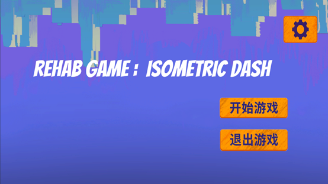
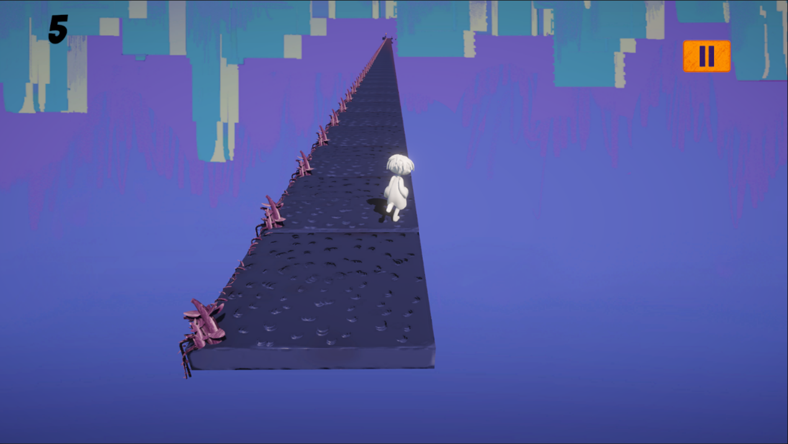
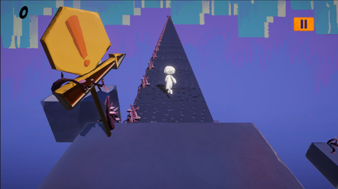
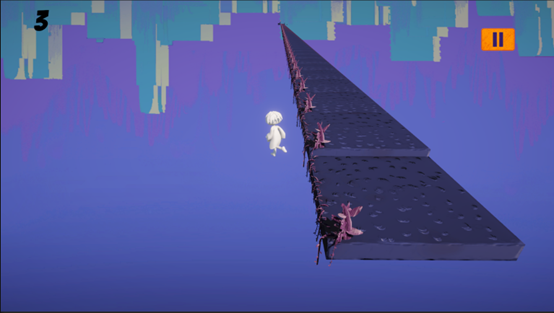

# Isometric Dash

`Isometric Dash` 是一款基于 Unity 制作的 3D 康复跑酷游戏原型。项目以中风患者腕关节康复训练为背景，把持续前进、路径保持、方向微调和结果反馈整合成一个更容易理解与坚持的轻量化训练流程。



## 项目概览

- 项目全称：`Isometric Dash`
- 项目类型：Unity 3D 康复跑酷游戏 / 康复训练交互原型
- 目标人群：中风患者腕关节康复训练用户
- Unity 版本：`2022.3.53f1c1`
- 渲染管线：`URP 14.0.11`
- 目标平台：`Windows`
- 主要场景：`Assets/Scenes/Start.unity`、`Assets/Scenes/SampleScene.unity`

## 玩法说明

当前版本是“自动前进 + 鼠标微调方向”的跑酷原型：

- 角色会持续向前移动
- 左右移动鼠标：调整前进方向
- `Esc`：暂停或恢复游戏
- 掉落出平台后失败
- 分数按时间持续增长，达到目标分数后胜利

这意味着它不是上一版那种“鼠标左右键分工”的控制，而是更接近单手即可体验的连续转向跑酷。

## 项目亮点

- 用更直观的跑酷反馈承载康复训练节奏
- 包含主菜单、设置、暂停、胜利、失败与返回主菜单的完整基础流程
- 保留 `PEAK PCAN`、`UDP`、`MySQL` 等外设与联调模块，便于后续继续接入康复系统
- 代码结构比纯演示场景更完整，已经具备继续整理成研究原型或课程作品的基础

## 运行要求

- `Unity Hub`
- `Unity 2022.3.53f1c1`
- `Windows`

如果需要继续联调康复硬件链路，还需要额外准备：

- `PEAK PCAN` 驱动与运行库
- 编码器 / CAN 外部设备
- 可选的 `Qt + UDP` 通信程序
- 可选的 `MySQL` 数据库环境

## 快速开始

1. 使用 `Unity Hub` 打开项目根目录。
2. 选择 `Unity 2022.3.53f1c1` 打开工程。
3. 按本机环境检查并填写 `config/config.ini`。
4. 打开 `Assets/Scenes/Start.unity`。
5. 点击 `Play` 进入主菜单，再开始游戏。

## 宣传图片

主页图：


游戏画面：







结算与失败界面：


## 目录结构

```text
Isometric/
├─ Assets/
│  ├─ Plugins/                  # 第三方 DLL，例如 MathNet、MySql.Data
│  ├─ Resources/                # 模型、预制体、背景、UI 素材
│  ├─ Scenes/
│  │  ├─ Start.unity
│  │  └─ SampleScene.unity
│  ├─ Scripts/
│  │  ├─ Entity/
│  │  ├─ QtMysqlUDP/
│  │  ├─ ScriptsUDP/
│  │  └─ *.cs
│  └─ Sounds/
├─ config/
│  └─ config.ini
├─ docs/
│  └─ images/
├─ Packages/
├─ ProjectSettings/
└─ guide.md
```

## 核心脚本

- `Assets/Scripts/PlayerMovement.cs`：角色移动、计分、胜利、失败与重开
- `Assets/Scripts/PlatformSpawner.cs`：直线路径平台生成与补充
- `Assets/Scripts/FallingPlatform.cs`：玩家离开后平台下落与销毁
- `Assets/Scripts/CameraFollow.cs`：跟随玩家的主相机
- `Assets/Scripts/MainMenuController.cs`：开始菜单、设置入口和 BGM 切换
- `Assets/Scripts/PauseController.cs`：暂停面板和返回主菜单
- `Assets/Scripts/QtMysqlUDP/ReadConfig.cs`：读取 `config/config.ini`
- `Assets/Scripts/ScriptsUDP/EncoderManager.cs`：编码器 / CAN 数据读取与角度映射

## 当前实现状态

- 已完成可直接游玩的单场景跑酷原型
- 主要可验证玩法链路是鼠标控制，不依赖外设即可运行
- 工程中保留了康复硬件、日志、数据库和 UDP 联调能力
- 当前更像“可继续迭代的研究 / 原型工程”，而不是完全整理好的产品级项目

## 详细指南

更完整的项目结构分析、脚本职责、场景说明、联调链路和技术债分析见：

- [guide.md](guide.md)

## 致谢

- 美术特别感谢：韩雨禾
- 建模特别感谢：鞠一鸣
